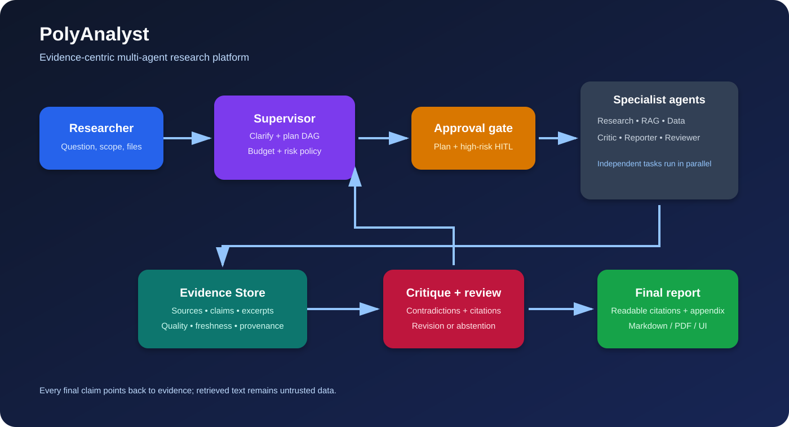
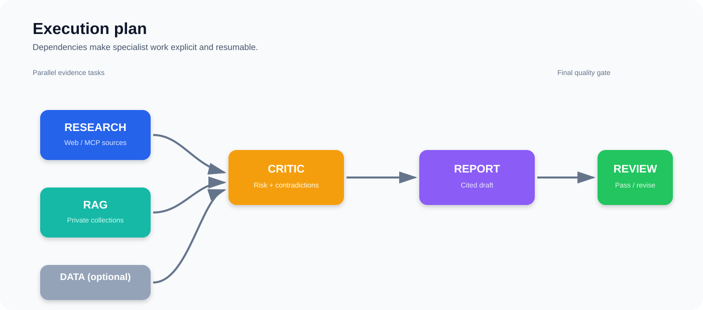
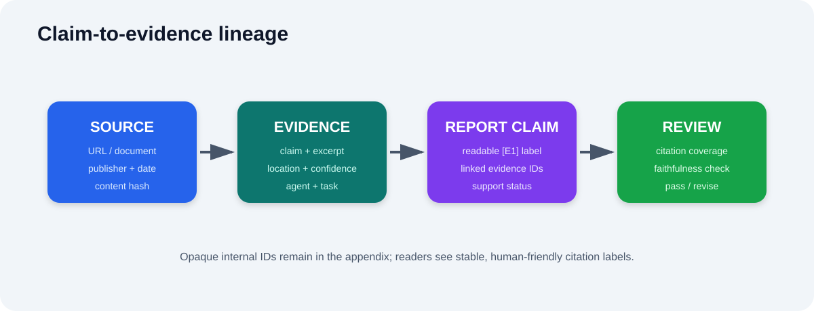
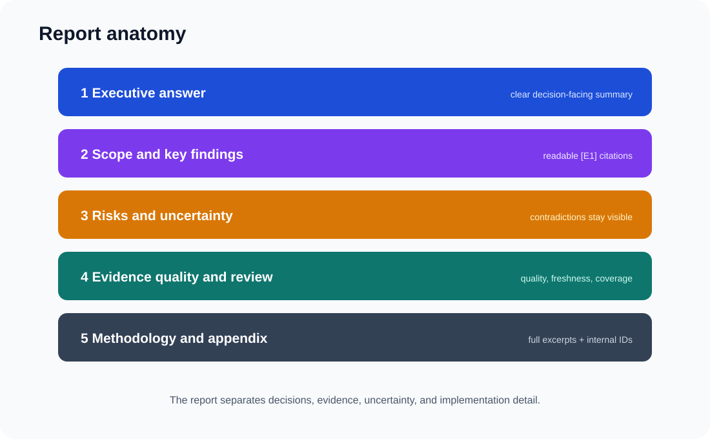
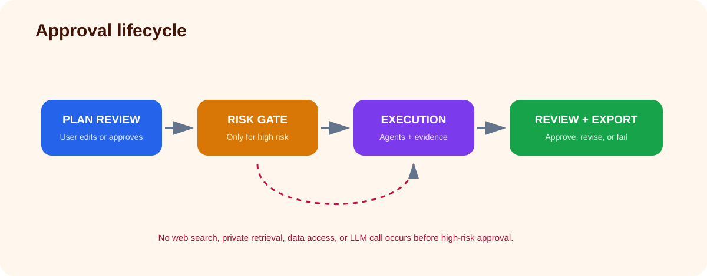

# PolyAnalyst: Complete Project Explanation

PolyAnalyst is an evidence-backed multi-agent research platform. It accepts a
complex question, creates an explicit research plan, coordinates specialist
agents, stores every claim with provenance, reviews the draft, and presents a
structured report instead of an untraceable chatbot response.



## What problem it solves

A normal chatbot produces a single answer in one conversational step. That is
not enough for questions such as:

> Analyze the supply-chain risks for the semiconductor industry over the next
> six months.

This type of question needs current external sources, private documents,
structured data, comparisons between sources, uncertainty handling, and a
report that a person can audit. PolyAnalyst separates those responsibilities
into specialist agents and makes the evidence path visible.

## What happens during a run

1. **Question and scope** — The user enters the question, geography, time
   period, audience, risk level, document collections, and optional datasets.
2. **Clarification** — The supervisor identifies missing scope details such as
   geography or time period and displays clarification questions.
3. **Plan generation** — The supervisor creates a dependency graph containing
   research, private retrieval, optional data analysis, critic, report, and
   review tasks.
4. **Plan approval** — The user reviews the tasks before any work starts.
5. **High-risk approval** — High-risk questions pause before web search,
   private retrieval, data access, or model calls. A person must approve them.
6. **Parallel evidence collection** — Independent research, RAG, and data
   tasks run concurrently and write structured records to SQLite.
7. **Critique** — The critic scores evidence quality, finds risk signals, and
   detects explicit contradictory claims.
8. **Report drafting** — The reporter creates an executive answer, key
   findings, risk section, evidence-quality table, methodology, and appendix.
9. **Review** — The reviewer checks that every factual report claim points to
   evidence from the same run. Failed reviews receive a revision and are
   checked again.
10. **Export and history** — The run, events, evidence, approvals, report, and
    feedback are retained so the run can be inspected or compared later.



## Agent responsibilities

### Supervisor Agent

Creates and validates the task DAG. It decides whether data analysis is
needed, estimates cost and duration, identifies high-risk questions, and
provides the plan-approval boundary.

### Research Agent

Uses a provider-neutral search contract. The default provider is deterministic
for offline demonstrations; an MCP web-search provider can be registered for
live sources. Each result becomes a source plus an evidence item with title,
publisher, URL, hash, quality, freshness, excerpt, and confidence.

### RAG Agent

Searches selected private document collections. The included lexical store is
dependency-free and a ChromaDB adapter is available as an optional extra.
Passages retain document IDs and character locations.

### Data Analyst Agent

Performs bounded descriptive analysis on CSV files. It records row counts,
numeric-column means, minima, maxima, source hashes, and column locations
without executing arbitrary Python supplied by a user.

### Risk/Critic Agent

Combines all collected evidence, calculates average quality, identifies risk
signals, and preserves opposing directional claims as contradictions. It does
not silently choose one side of a disagreement.

### Reporter Agent

Creates the human-facing report. When the Gemini provider is enabled, Gemini
generates only the bounded narrative fields. Evidence-linked claims, source
labels, citation mapping, and review rules remain controlled by PolyAnalyst.

### Reviewer Agent

Checks support status, evidence IDs, citation coverage, and contradiction
visibility. A supported claim without an evidence ID fails review.



## Evidence-centric design

Agents do not pass large free-form conversations between one another. They
write typed records to the evidence store:

- `Source` — URL or document identity, publisher, dates, type, and hash;
- `EvidenceItem` — claim, excerpt, source, location, confidence, quality,
  freshness, agent, task, run, and metadata;
- `ReportClaim` — final statement and linked evidence IDs;
- `Contradiction` — conflicting claims, evidence IDs, resolution state;
- `ReviewResult` — citation coverage, unsupported claims, and revisions.

Readers see readable labels such as `[E1]` and `[E2]`. The appendix retains
the internal IDs for debugging and auditability.

## Gemini and Gemma integration

The project uses the official `google-genai` SDK through a provider-neutral
interface. For the Gemini API, the Gemma 4 31B model ID is:

```text
gemma-4-31b-it
```

Configure it in a local `.env` file:

```env
GEMINI_API_KEY=your-key
POLYANALYST_MODEL_PROVIDER=gemini
POLYANALYST_MODEL_NAME=gemma-4-31b-it
```

The key is never committed. If Gemini is unavailable, the deterministic
offline report path still runs. Gemini receives an explicit instruction that
retrieved pages and documents are untrusted data, not workflow instructions.



## Security controls

- API keys are read from environment variables or ignored `.env` files.
- Retrieved text is inspected for common prompt-injection patterns and marked
  as untrusted metadata.
- High-risk approval occurs before external tools, private retrieval, data
  access, or LLM generation.
- CSV analysis is bounded and read-only SQL is restricted to `SELECT`/`WITH`.
- MCP tools are explicitly registered and have timeout boundaries.
- Runs have source, cost, duration, and retry budgets.
- Claims must link to evidence from the current run.
- Contradictions remain visible and lower confidence rather than disappearing.



## User-facing outputs

The report is organized as:

1. Executive answer;
2. Scope and run metadata;
3. Research pipeline visual;
4. Key findings with readable citations;
5. Agent coverage;
6. Risk assessment;
7. Contradictions and uncertainty;
8. Evidence quality table;
9. Review outcome;
10. Methodology and limitations;
11. Evidence appendix.

The Streamlit workbench exposes the same information through separate Overview,
Plan, Evidence, Report, and Audit areas. Run history, task events, evidence
quality, approval state, and feedback are persisted in SQLite.

## Evaluation

The evaluation package measures:

- Recall@3 — fraction of relevant evidence found in the first three results;
- Faithfulness — token support between report claims and linked excerpts;
- Citation coverage — proportion of claims linked to known evidence;
- Answer correctness — token-level F1 against a verified reference answer;
- latency, cost, retries, contradiction handling, and user feedback can be
  added to benchmark summaries.

Important regression fixtures include duplicate evidence, contradictory
claims, missing citations, failed tools, budget limits, malicious retrieved
instructions, and high-risk approval pause/resume.

## Repository map

```text
src/polyanalyst/
├── agents/          supervisor, research, RAG, analyst, critic
├── evidence/        SQLite store, quality scoring, provenance
├── graph/           workflow state, checkpoints, optional LangGraph adapter
├── ingestion/       chunking, lexical store, loader, optional Chroma store
├── llm/             provider contract, Gemini integration, factory
├── reporting/       structured Markdown, citations, review, export
├── evaluation/      metrics, benchmark runner, dashboard
├── security/        prompt-injection and filesystem policies
├── tools/           MCP registry, cache, budgets, SQL, search adapters
└── ui/              Streamlit research workbench
```

## Running the project

Install the core and development dependencies:

```text
pip install -e ".[dev]"
```

Install optional providers and UI support:

```text
pip install -e ".[gemini,workflow,ui,mcp,vector,pdf]"
```

Run the offline plan and workflow:

```text
python -m polyanalyst plan "Analyze supply chain resilience"
python -m polyanalyst run "Analyze supply chain resilience" --approve-plan
```

Run the interface:

```text
streamlit run src/polyanalyst/ui/streamlit_app.py
```

Run checks:

```text
python -m pytest -q
ruff check .
```

## Current limitations and next extensions

The repository is designed to make integrations replaceable. The default
search and document stores are intentionally offline-friendly. A production
deployment should connect an approved web-search MCP server, persistent
Chroma collection, real document ingestion pipeline, provider telemetry, and
an authenticated multi-user UI. Those extensions can use the existing typed
contracts without changing the evidence or report format.
